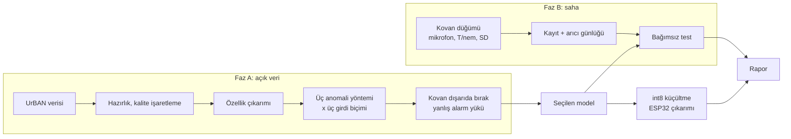
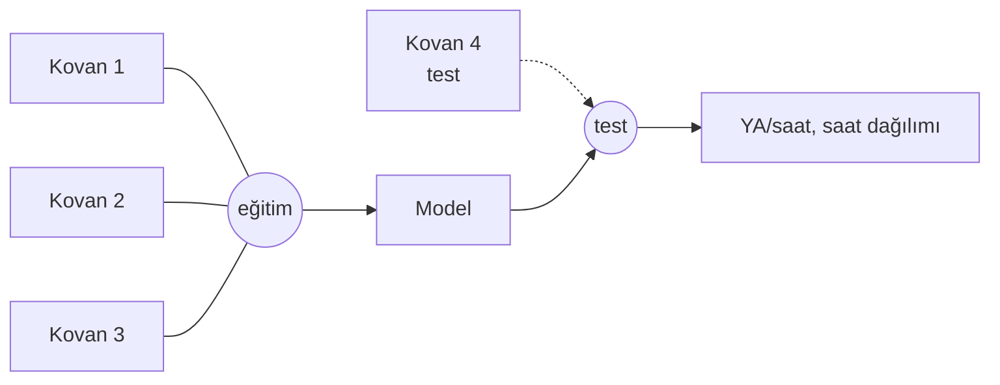

# Diyagramlar

Sistem şeması ve deney tasarımı `Proje_Tanitim.pdf` içindedir. Burada algoritma akışları verilmiştir.

## D1. İki aşamalı yapı



## D2. Girdi biçimleri

```mermaid
flowchart TB
    S[Ses özellikleri] --> G1[G1: yalnız ses]
    S --> G2[G2: ses + çevre]
    C[Çevre: T, nem, değişim] --> G2
    C --> G3[G3: çevre koşullu<br/>f(çevre) → beklenen ses]
    S --> G3
    G3 --> K[Kalıntı skoru]
```

## D3. Kovan dışarıda bırakma



Her turda test kovanı değişir. Bir kovanın hiçbir penceresi eğitimde bulunmaz.

## D4. Saha kaydı zamanlaması

```mermaid
gantt
    title Faz B kayıt ve doğrulama (aylar)
    dateFormat X
    axisFormat %s
    section Hazırlık
    Düzenek, arıcı onayı, pilot : 2, 3
    section Kayıt
    Saha kaydı + günlük : 3, 6
    section Çıkarım
    Uç cihaz küçültme ve ölçüm : 5, 7
    section Doğrulama
    Bağımsız test, rapor : 6, 8
```


