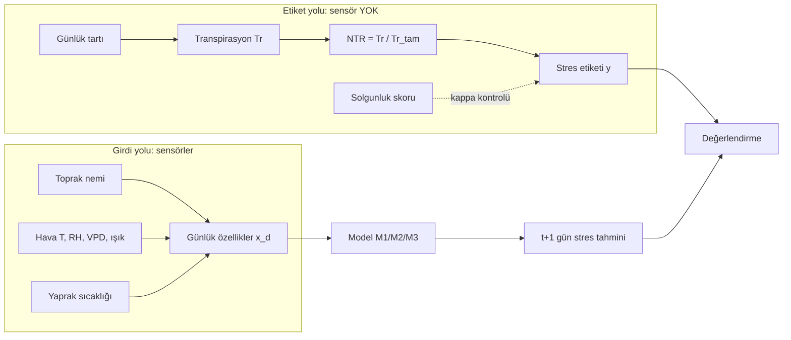
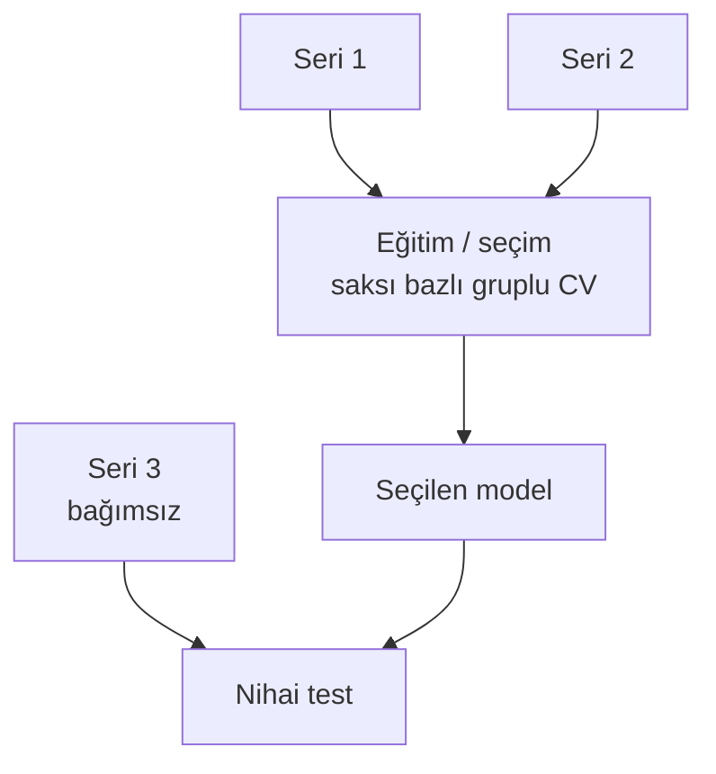
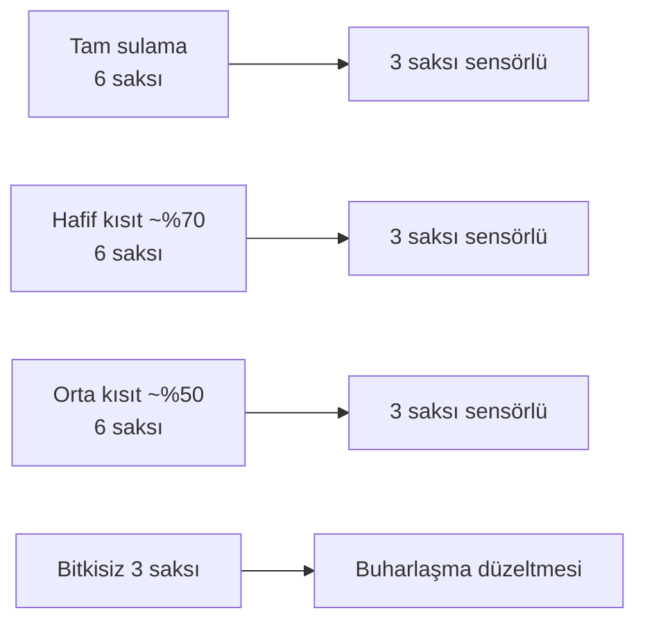

# Diyagramlar

Sistem şeması ve deney tasarımı `Proje_Tanitim.pdf` içindedir. Burada algoritma akışları verilmiştir.

## D1. Etiket ve girdi ayrımı (projenin ana fikri)



## D2. Seri ve saksı bazlı bölme



## D3. Üç sulama grubu ve izleme



## D4. Bir serinin zaman çizgisi

```mermaid
gantt
    title Bir deney serisi (yaklaşık 6-7 hafta)
    dateFormat X
    axisFormat %s
    section Hazırlık
    Fide uyumu (2 hf) : 0, 2
    section Deney
    Sulama koşulları (4-5 hf) : 2, 7
    section Seri sonu
    Biyokütle ve yaprak alanı : 7, 8
```



## D5. Karar akışı (model tabanlı uyarı)

```mermaid
flowchart TD
    A[Gün d verileri] --> B[Özellik x_d]
    B --> C{p stres > τ?}
    C -- evet --> D[Uyarı: yarın stres olası]
    C -- hayır --> E[Uyarı yok]
    D --> F[Doğrulama: NTR_{d+1} < θ mı?]
    E --> F
    F --> G[TP / FP / FN / TN, erken uyarı süresi]
```
