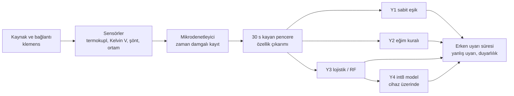
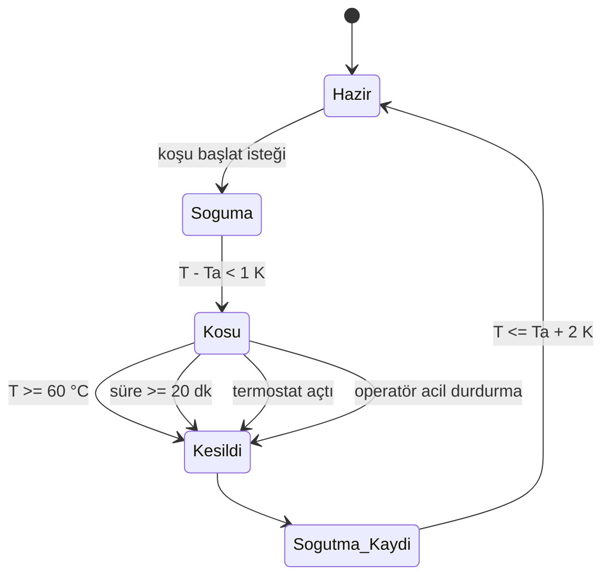
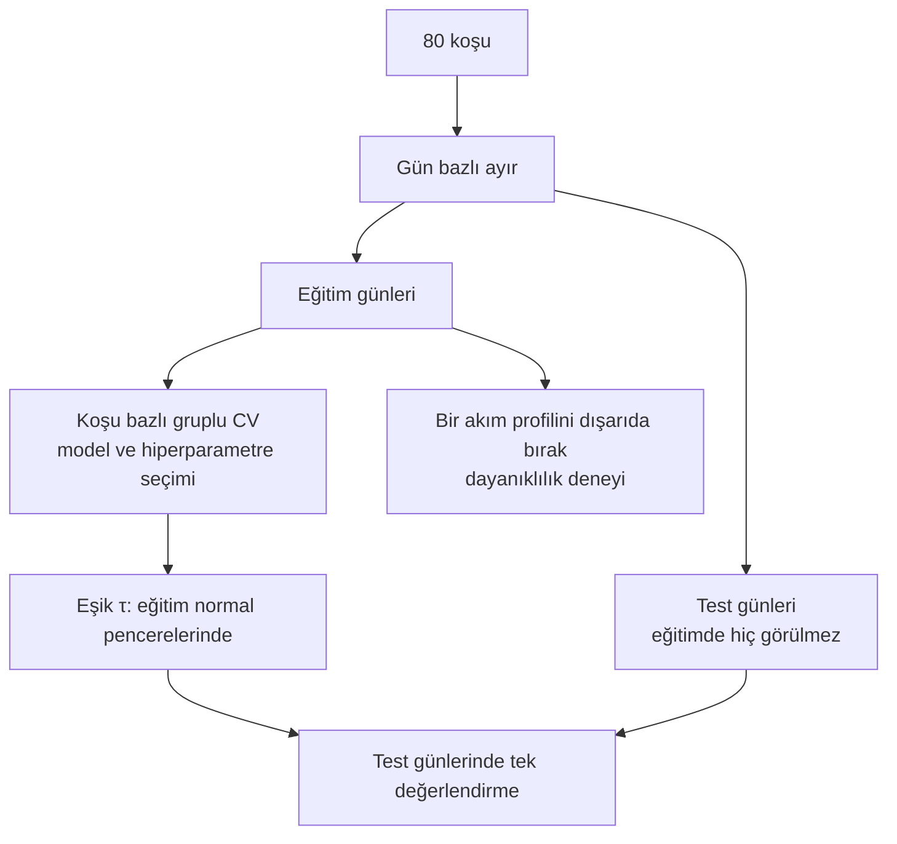
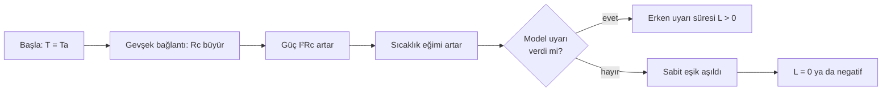

# Diyagramlar

Sistem şeması ve deney tasarımı şeması `Proje_Tanitim.pdf` içinde yer alır. Burada algoritma ve güvenlik akışları verilmiştir. Mermaid destekleyen bir görüntüleyicide çizim olarak görünür.

## D1. Veri ve karar hattı

## D2. Güvenlik durum makinesi

## D3. Veri bölme (sızıntıyı önleyen düzen)

## D4. Isınma eğrisinin okunuşu (kavramsal)

