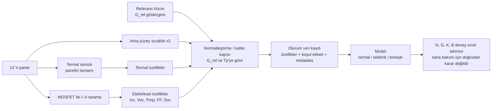
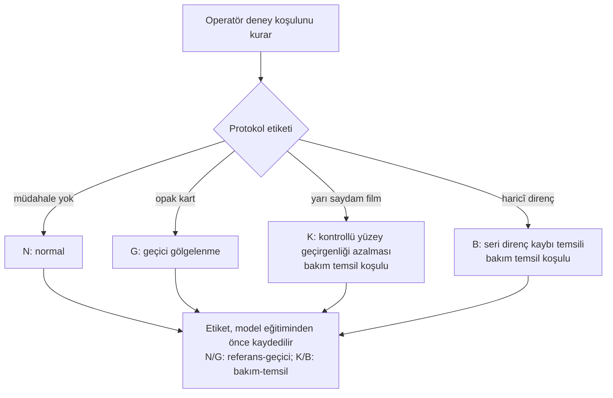
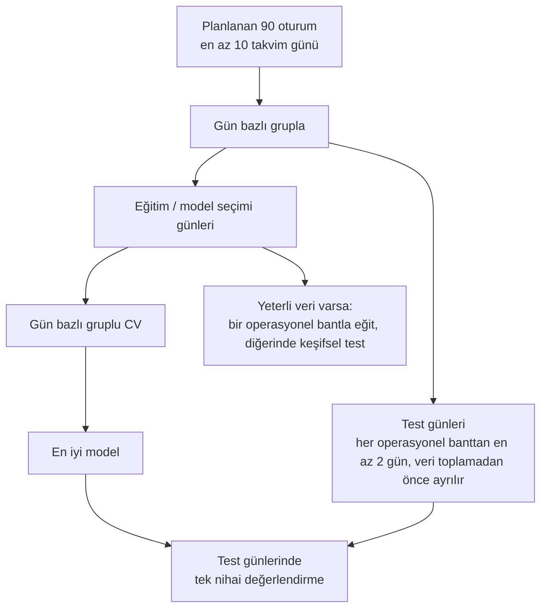
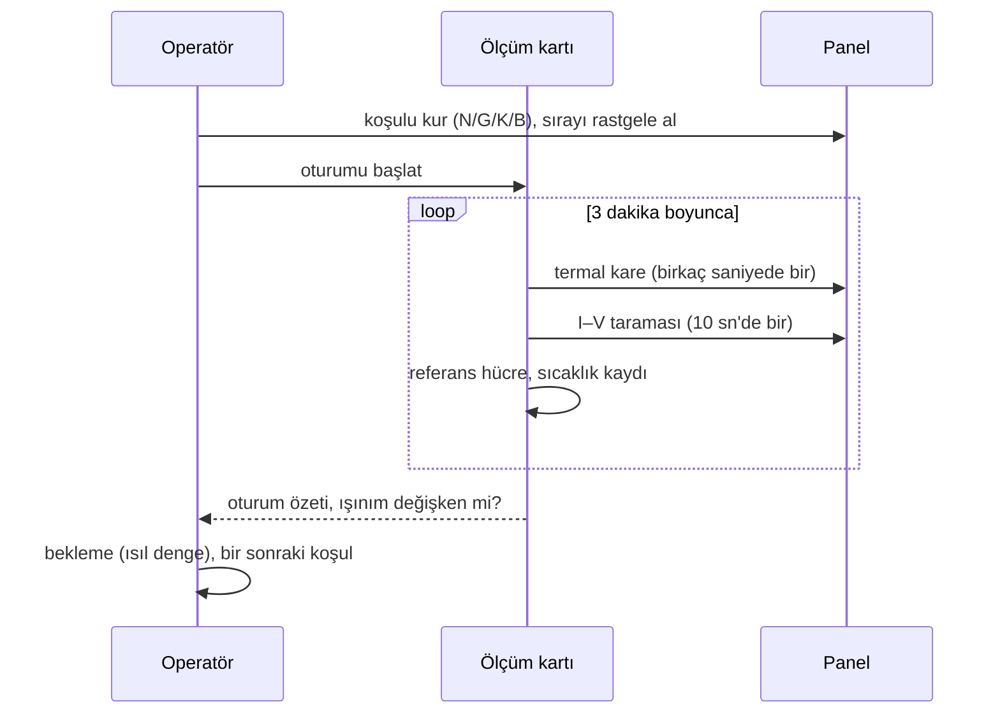

# Diyagramlar

Sistem şeması ve deney tasarımı `Proje_Tanitim.pdf` içindedir. Burada algoritma akışları verilmiştir.

## D1. Veri hattı

## D2. Kontrollü sınıf etiketleme mantığı

## D3. Veri bölme

## D4. Oturum akışı

