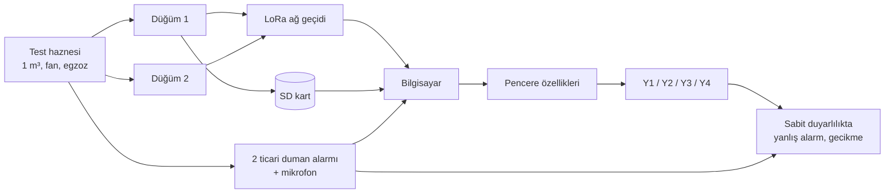
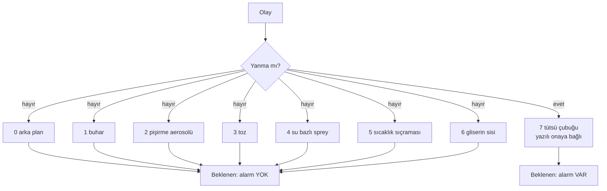
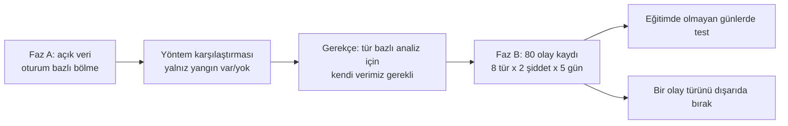
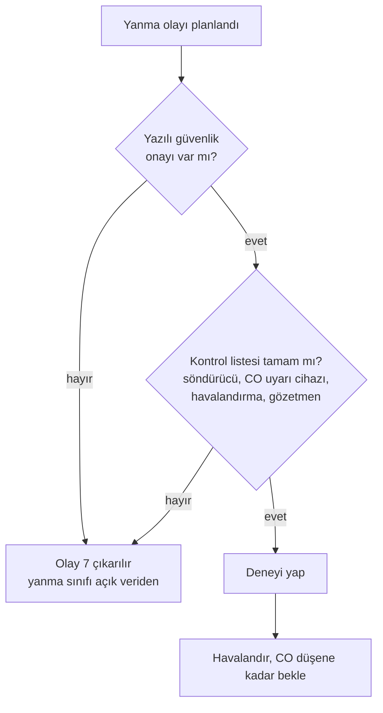
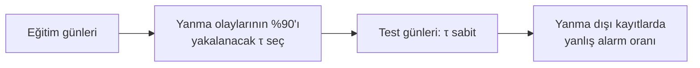

# Diyagramlar

Sistem şeması ve deney tasarımı `Proje_Tanitim.pdf` içindedir. Burada algoritma ve güvenlik akışları verilmiştir.

## D1. Veri hattı

## D2. Olay türleri ve beklenen alarm

## D3. Faz A ve Faz B

## D4. Yanma deneyi için güvenlik kapısı

## D5. Sabit duyarlılıkta karşılaştırma

