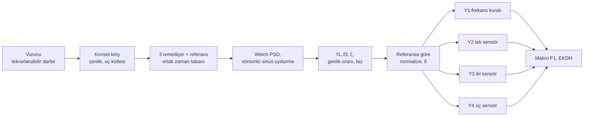
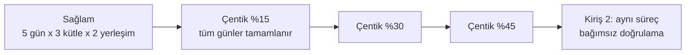
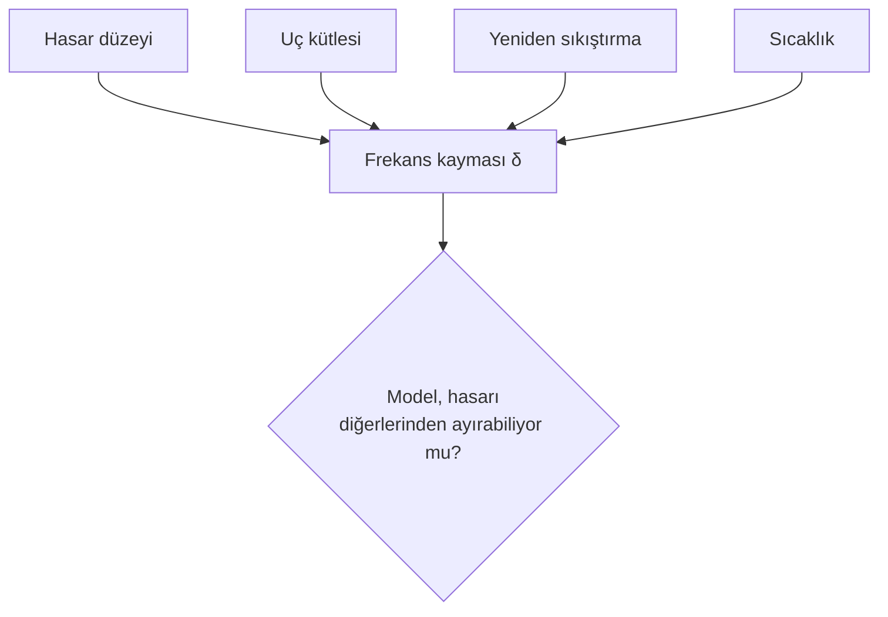
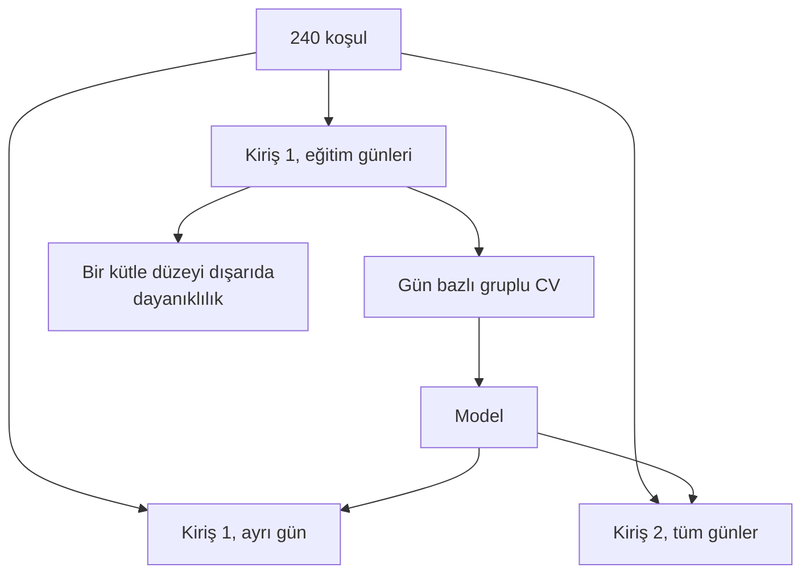

# Diyagramlar

Sistem şeması ve deney tasarımı `Proje_Tanitim.pdf` içindedir. Burada algoritma akışları verilmiştir.

## D1. Ölçümden karara

## D2. Çentik ilerleyişi (geri alınamaz adımlar)

Bir sonraki adıma, mevcut adımın bütün günleri tamamlanmadan geçilmez.

## D3. Karıştırıcılar ve hasar etkisi

## D4. Veri bölme

